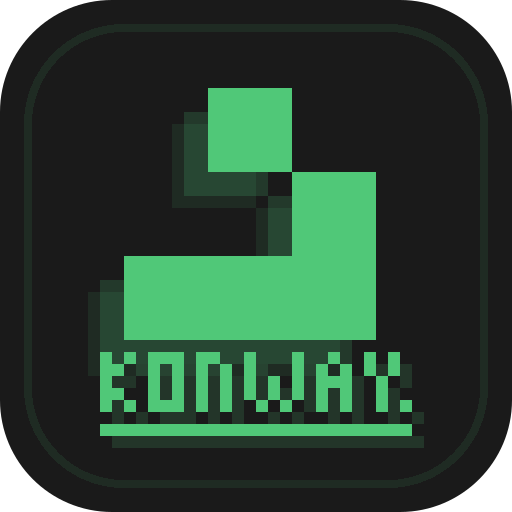
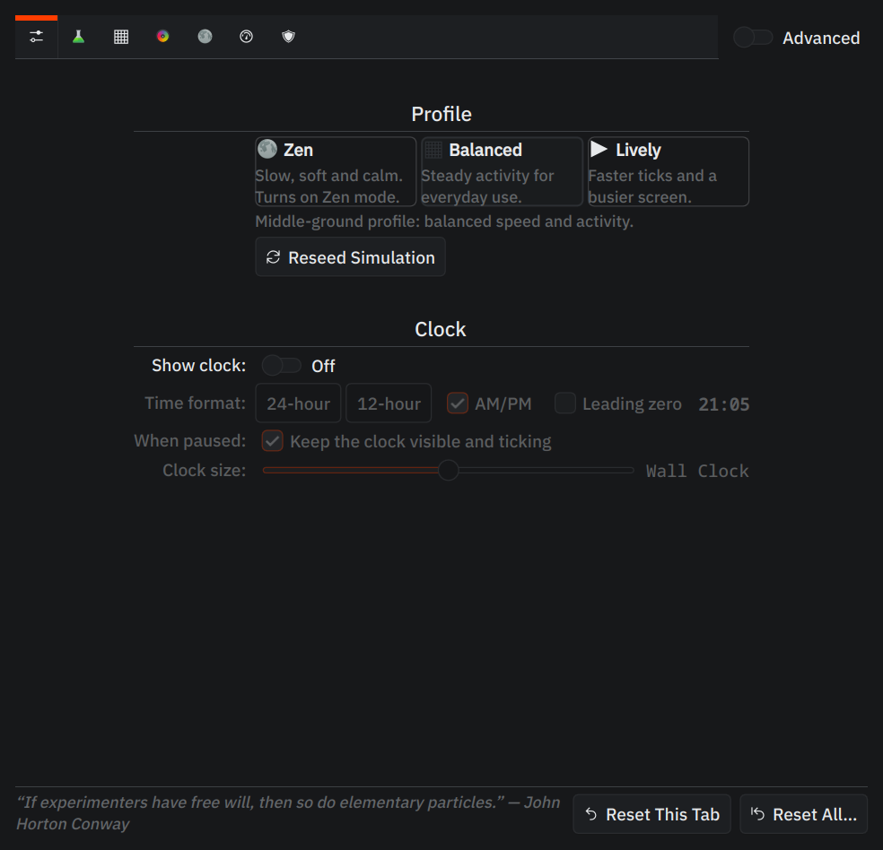
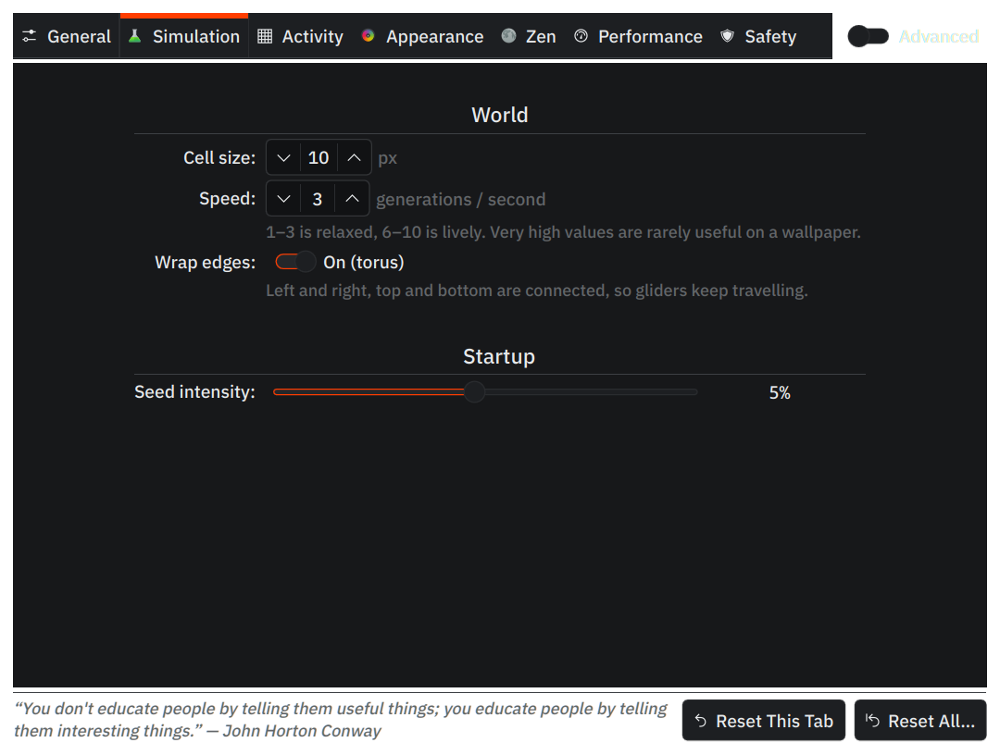
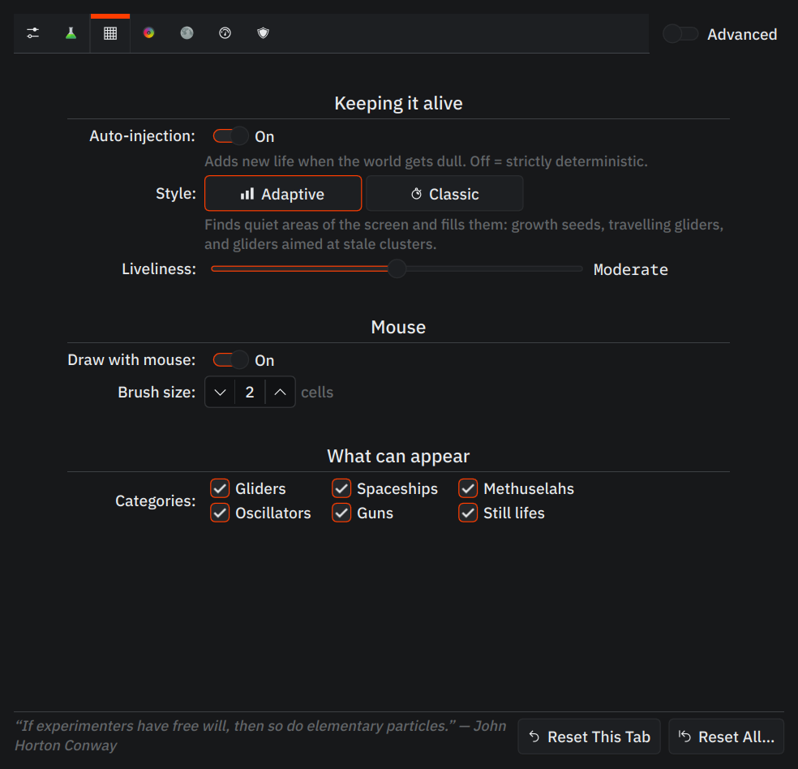
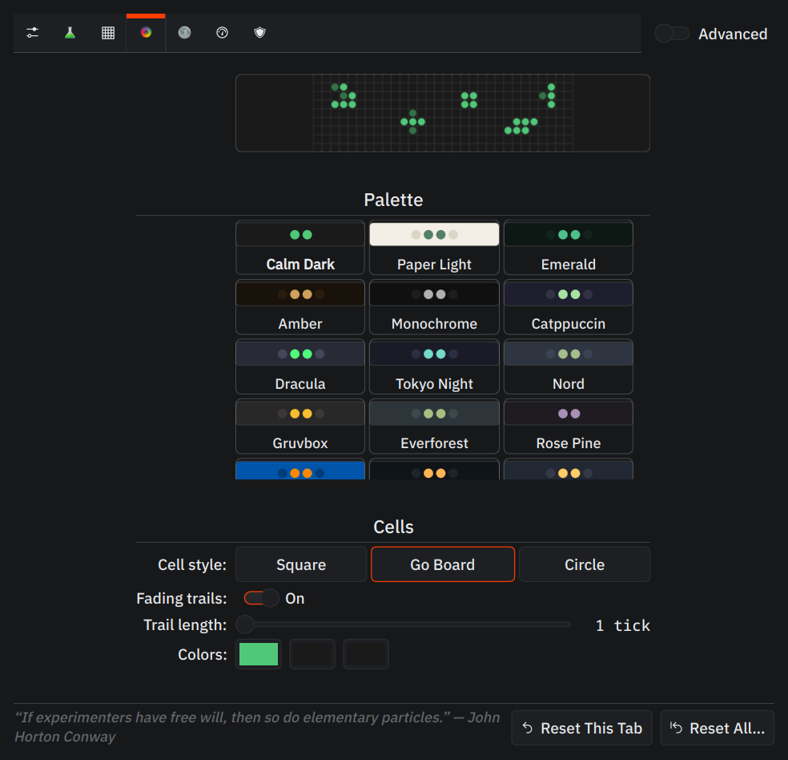
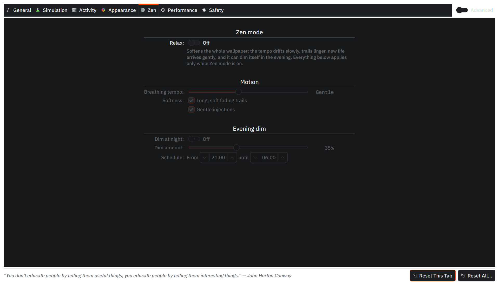
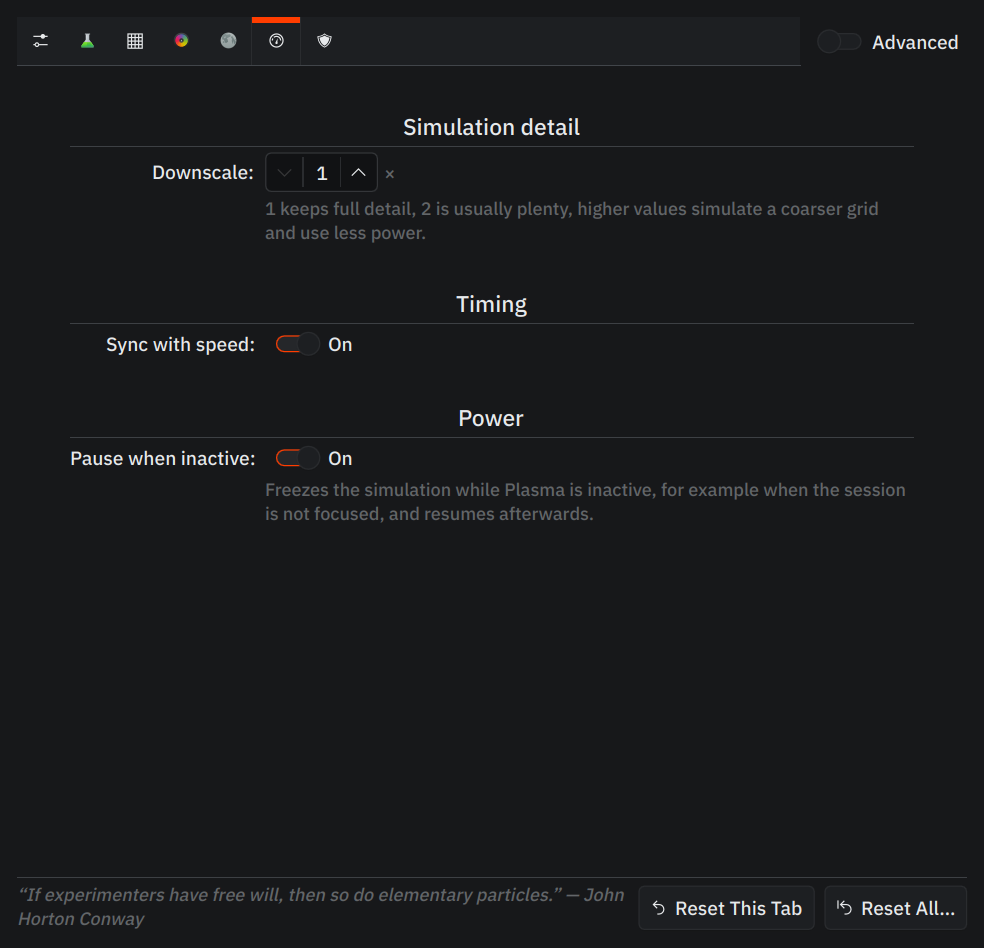
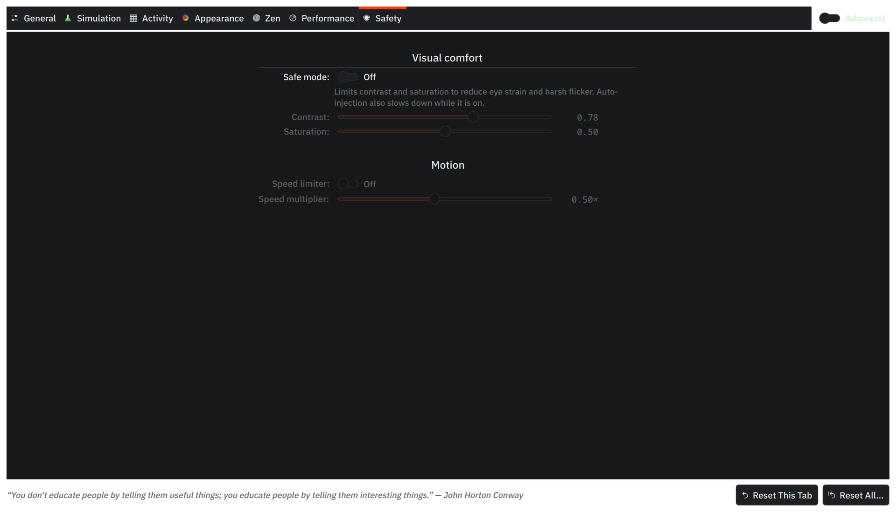

# Konway

<p align="center">
  
</p>

A lightweight Conway's Game of Life live wallpaper for KDE Plasma 6. The simulation runs on the GPU.

[demo.webm](https://github.com/user-attachments/assets/09198183-d5c2-430a-a4b2-1fdf05154a2e)

## Settings

<table>
  <tr>
    <td width="50%" align="center"><br><small><b>General</b></small><br><sub>Profiles (Zen, Balanced, Lively), reseed, and the clock: 24h/12h, AM/PM, size.</sub></td>
    <td width="50%" align="center"><br><small><b>Simulation</b></small><br><sub>Cell size, speed, wrap edges and startup seed intensity. Rules under Advanced.</sub></td>
  </tr>
  <tr>
    <td width="50%" align="center"><br><small><b>Activity</b></small><br><sub>Auto-injection style and liveliness, mouse drawing, allowed pattern categories.</sub></td>
    <td width="50%" align="center"><br><small><b>Appearance</b></small><br><sub>48 palettes, cell style, fading trails and custom colors.</sub></td>
  </tr>
  <tr>
    <td width="50%" align="center"><br><small><b>Zen</b></small><br><sub>Breathing tempo, soft trails, gentle injections and evening dim.</sub></td>
    <td width="50%" align="center"><br><small><b>Performance</b></small><br><sub>Simulation downscale, timing and pause when inactive.</sub></td>
  </tr>
  <tr>
    <td colspan="2" align="center"><br><small><b>Safety</b></small><br><sub>Contrast and saturation limits and a speed limiter.</sub></td>
  </tr>
</table>

## Features

- **GPU simulation:** the world lives in a texture and a shader computes each generation, so there is no per-cell CPU loop. It stays light even on older machines.
- **Adaptive auto-injection:** classic Life settles into a few static blinkers and still lifes. Konway reduces the grid to a small activity map on the GPU, finds the areas that have gone quiet, and responds there: growth seeds (R-pentomino, Acorn and other long-lived patterns) in empty areas, gliders drifting across empty space, small random soups, and gliders aimed at leftover clusters that have stopped changing. One **Liveliness** slider sets how busy the screen is kept. The older timer-based injector is still available as **Classic**, and injection can be switched off for a strictly deterministic run.
- **Zen mode:** a relaxing profile with a slowly breathing tempo, long soft trails, gentle injections (mostly drifting gliders), and an optional evening dim on a schedule.
- **Profiles:** Zen, Balanced and Lively set speed, cell size, injection and power options together.
- **48 palettes:** Catppuccin, Dracula, Nord, Gruvbox, Tokyo Night, Rose Pine, Kanagawa, One Dark, Solarized Dark, Game Boy, Commodore 64 and more, plus fully custom colors and three cell styles (Square, Go Board, Circle).
- **Clock overlay:** 24-hour or 12-hour with optional AM/PM and leading zero, in seven sizes. Cells never grow into it, and it keeps ticking while the simulation is paused (can be turned off).
- **Any B/S rule:** Life (`B3/S23`), HighLife (`B36/S23`), Day & Night (`B3678/S34678`), Seeds (`B2/S`) and others.
- **Mouse:** click places a glider, drag paints cells.
- **Comfort options:** fading phosphor-style trails, contrast and saturation limits, and a speed limiter.
- **Power:** pauses when Plasma is inactive (on by default) and lowers detail automatically if the grid gets too dense.

## Settings tabs

| Tab | What it controls |
| --- | --- |
| General | Profiles, reseed, clock (format, size, AM/PM, paused behavior) |
| Simulation | Cell size, speed, wrap edges, startup seed intensity, B/S rules |
| Activity | Auto-injection style and liveliness, mouse drawing, allowed pattern categories, pattern library |
| Appearance | Palettes, cell style, fading trails, custom colors |
| Zen | Breathing tempo, soft fades, gentle injections, evening dim |
| Performance | Downscale, timing, pause when inactive |
| Safety | Contrast, saturation and speed limits |

The **Advanced** switch reveals rarely needed options on every tab. The window also works at small sizes.

## Install

**KDE Store:** Desktop and Wallpaper → Get New Plugins → search `Konway`.

**From source:**

```bash
git clone https://github.com/arcanorca/Konway.git
cd Konway
./tools/deploy_local.sh
```

**From a package:**

```bash
kpackagetool6 --type Plasma/Wallpaper --upgrade dist/com.github.arcanorca.konway-<version>.kpackage.tar.gz
```

If Plasma shows the old version, restart it:

```bash
kquitapp6 plasmashell && kstart plasmashell
```

## Development

- Rebuild shaders: `./tools/build_shaders.sh`
- Rebuild the pattern index after editing `.rle` files: `./tools/build_patterns_index.py`
- Build install packages into `dist/`: `./tools/build_kpackage.sh`
- Check the adaptive injector without Plasma: `node tools/simulate_injection.js`

## Changelog

### 0.2.0

- New Adaptive injector (Classic stays selectable).
- New Zen mode; profiles are now Zen, Balanced, Lively.
- 12-hour clock with AM/PM; clock keeps ticking while paused.
- 48 palettes with a larger picker.
- Redesigned settings that work in small windows.
- Pause when inactive is on by default; speed is capped at 20.

### 0.1.1

- Adjustable fade length (1 to 8 ticks), clock polish, new clock sizes, settings cleanup.

## License

GPL-3.0-or-later. Built with KDE Plasma 6, Qt 6 (QML/JS), GLSL.

<p align="center">
  <i>Dedicated to the memory of John Horton Conway.</i>
</p>
